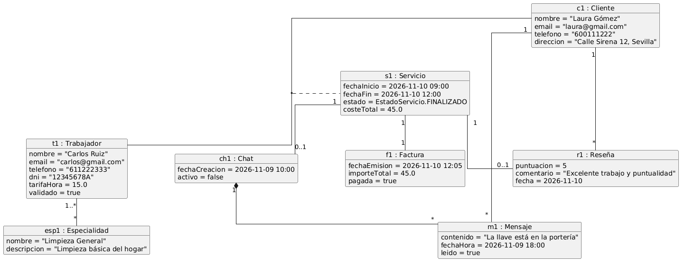
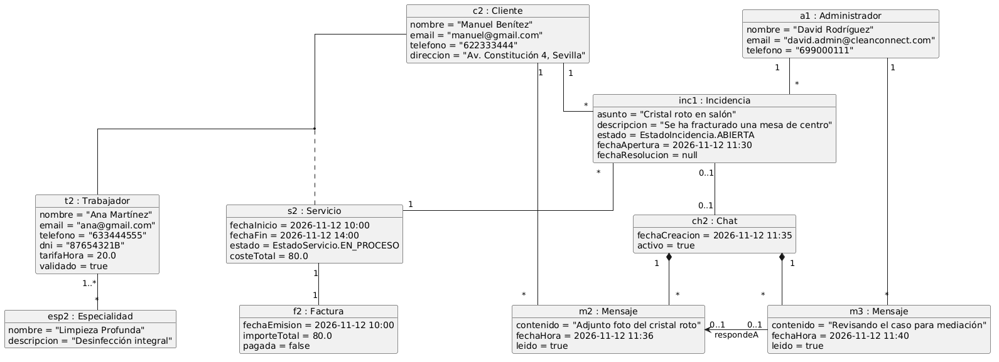

# CleanConnect

## Miembros del grupo L8-AM-3

1. Rodríguez Ortiz, David
2. Pérez Dot, Pol
3. Rodríguez González, Gerard
4. Ruiz Núñez, Manuel

---

## 1. Introducción al problema
Hoy en día, el ritmo de vida que llevamos y las jornadas de trabajo eternas hacen que las familias y los profesionales independientes no tengan tiempo libre. De toda la vida, contratar a alguien para limpiar en casa siempre ha sido gracias a recomendaciones de conocidos o gracias a agencias cuyas comisiones son altísimas. Al final de todo, es un sector donde hay muchísimo trabajo en negro, los precios nunca están fijados y cuesta la misma vida dar con alguien, establecer confianza y hallar huecos donde la persona este disponible.

En cuanto a los clientes, los principales problemas son la falta de confianza para meter a una persona ajena en tu casa, lo difícil que es encontrar a alguien disponible a las horas que te interesan, tener que pagar siempre en efectivo y no tener ningun tipo de referencia o descripción sobre la actitud de la persona.

En cuanto a los profesionales, se encuentran con que les cuesta bastante dar con clientes fijos, sufren impagos o cancelaciones a última hora, pierden muchísimo tiempo entre casa y casa, y encima no tienen herramientas profesionales para organizarse en el dia a dia.

Para solucionar todo esto proponemos el proyecto CleanConnect, que busca digitalizar y estructurar este sector mediante una aplicación móvil y web al estilo de Uber. La plataforma servirá de intermediaria para asegurar que los clientes puedan encontrar a alguien rápido de manera sencilla, ver perfiles con identidad verificada, consultar opiniones con estrellas y comentarios, y pagar de forma segura. Mientras tanto, a los profesionales les garantiza flexibilidad de horarios, cobrar siempre de manera segura, gestionar su agenda fácilmente e ir construyendo su propia reputación en el sector.

---

## 2. Glosario de términos
-)Usuario: Representa a cualquier persona registrada en la plataforma (cliente, trabajador o administrador). Almacena los datos de perfil básicos, las credenciales de acceso y permite gestionar acciones comunes, como el reporte de incidencias.

-)Cliente: Usuarios que solicitan y contratan los servicios de limpieza. Almacena sus datos personales, de contacto y su dirección.

-)Trabajador: Representa a los profesionales que ofrecen sus servicios en la plataforma. Incluye sus datos personales, el estado de verificación de su identidad, zona de trabajo y disponibilidad.

-)Administrador: Representa al personal interno encargado de la gestión y supervisión de la plataforma. Almacena sus datos de acceso y permisos para validar las cuentas de los trabajadores, gestionar las especialidades y resolver las incidencias reportadas.

-)Especialidad: Representa los distintos tipos de limpieza que se ofrecen. Sirve para categorizar las habilidades del trabajador y facilitar la búsqueda al cliente.

-)Servicio: Es la entidad principal de la plataforma. Representa la reserva de un trabajo de limpieza concreto entre un cliente y un trabajador, guardando la fecha, hora, duración, ubicación, estado y la especialidad contratada.

-)Reseña: Guarda la valoración que realiza un cliente al terminar el servicio. Incluye una puntuación en estrellas y un comentario para construir la reputación pública del profesional.

-)Incidencia: Registra los problemas reportados por un cliente o un trabajador sobre un servicio para que el administrador pueda gestionarlos, mediar y resolverlos.

-)Factura: Almacena los datos del pago y del comprobante de cada servicio realizado. Desglosa el importe total, la comisión de la plataforma y los impuestos, registrando el estado detallado del cobro (como Pendiente, Retenida o Pagada) para gestionar correctamente los pagos o bloqueos por disputas.

-)Chat: Sala de comunicación independiente vinculada obligatoriamente a un servicio. Agrupa la conversación activa entre el cliente y el trabajador asignado, registrando su estado de actividad y fecha de creación.

-)Mensaje: Interacción individual enviada dentro de un chat. Incluye la fecha, la hora de envío y el contenido del texto intercambiado entre los usuarios.
  
---

## 3. Visión general del sistema

### 3.1. Requisitos generales

#### R.G.01. Gestión de usuarios
Como usuario del sistema

Quiero gestionar mis datos personales y de acceso

Para identificarme y autenticarme correctamente dentro de la plataforma

#### R.G.02. Gestión de administradores del sistema
Como administrador del sistema

Quiero gestionar las cuentas y perfiles de los administradores

Para garantizar la supervisión y mantenimiento de la plataforma

#### R.G.03. Gestión de clientes
Como cliente

Quiero gestionar una cuenta y un perfil de cliente

Para poder contratar los servicios de limpieza de un trabajador

#### R.G.04. Gestión de trabajadores
Como trabajador

Quiero gestionar una cuenta y un perfil de trabajador

Para ofrecer mis servicios y poder ser contratado por un cliente

#### R.G.05. Gestión de especialidades
Como administrador del sistema

Quiero gestionar las especialidades de limpieza disponibles

Para categorizar los servicios que pueden ofrecer los trabajadores

#### R.G.06. Gestión de servicios
Como cliente o trabajador

Quiero gestionar las reservas de servicios de limpieza

Para coordinar la asistencia del profesional al domicilio

#### R.G.07. Gestión de reseñas
Como cliente

Quiero gestionar las reseñas sobre los trabajadores

Para construir la reputación pública de los profesionales

#### R.G.08. Gestión de incidencias
Como administrador del sistema

Quiero gestionar las incidencias reportadas por los clientes

Para resolver mediaciones y disputas de forma justa

#### R.G.09. Gestión de chats
Como cliente o trabajador

Quiero gestionar la apertura y estado de las salas de chat asociadas a un servicio

Para mantener un canal de comunicación activo y organizado sobre el trabajo a realizar

#### R.G.10. Gestión de mensajes
Como cliente o trabajador

Quiero gestionar los mensajes enviados dentro de un chat

Para intercambiar detalles específicos sobre la ejecución del servicio

#### R.G.11. Gestión de facturas
Como administrador del sistema

Quiero gestionar las facturas de los servicios de los clientes

Para garantizar el cobro correcto y permitir la consulta del historial de pagos 

---
  
### 3.2. Usuarios del sistema
- Administrador: Representa al personal interno encargado de la gestión y supervisión de la plataforma. Almacena sus datos de acceso y permisos para validar las cuentas de los trabajadores, gestionar las especialidades y resolver las incidencias reportadas.
  
- Cliente: Usuario que solicita y contrata los servicios de limpieza. Almacena sus datos personales, de contacto y su dirección.
  
- Trabajador: Representa a los profesionales que ofrecen sus servicios en la app. Incluye sus datos personales, el estado de verificación de su identidad, zona de trabajo y disponibilidad.

## 4. Catálogo de requisitos

### 4.1. Requisitos funcionales

#### RF.01. Suma total de los importes de los pagos
Consulta para calcular la suma de los importes totales de las facturas (usando el atributo importeTotal) que están marcadas como pagadas (pagada = true).   

#### RF.02. Listado de clientes con más citas
Consulta para obtener un listado de clientes (mostrando su nombre y dirección) ordenados de forma descendente por el número total de servicios que han contratado en la plataforma.   

#### RF.03. Trabajadores mejor valorados por especialidad
Consulta para listar el nombre, DNI y tarifaHora de los trabajadores, ordenados por la nota media de la puntuacion de sus reseñas, filtrando exclusivamente por una especialidad concreta.   

#### RF.04. Servicios finalizados con facturas pendientes
Consulta para obtener los servicios cuyo estado sea FINALIZADO, pero cuya factura asociada mantenga el campo pagada en falso, mostrando el email y teléfono del cliente deudor para poder contactarle.   

#### RF.05. Historial de incidencias de un trabajador
Consulta para listar todas las incidencias (mostrando asunto, estado y fechaApertura) asociadas a los servicios que ha realizado un trabajador específico a lo largo del tiempo.   

#### RF.06. Mensajes no leídos en chats activos
Consulta para obtener el contenido y fechaHora de los mensajes que tienen el atributo leido en falso, pertenecientes únicamente a chats cuyo campo activo sea verdadero, indicando a qué servicio pertenecen.   

#### RF.07. Productividad de administradores en incidencias
Consulta para listar el nombre de cada administrador junto con el recuento total de incidencias que han gestionado y que se encuentran actualmente en estado RESUELTA, evaluando así su volumen de resolución.   

#### RF.08. Recaudación por cancelación de servicios
Consulta para calcular la suma del costeTotal de los servicios que se encuentran en estado CANCELADO, cruzando con su factura asociada para ver si dicha penalización figura como pagada. 

#### RF.09. Catálogo de especialidades
Consulta para obtener el nombre y la descripciónn de todas las especialidades de limpieza registradas en el sistema, ordenadas alfabéticamente.   

#### RF.10. Búsqueda de trabajadores por tarifa
Consulta para listar el dni y la tarifaHora de los trabajadores cuya tarifa sea menor o igual a un importe específico fijado en la búsqueda.   

#### RF.11. Control de incidencias en revisión
Consulta para obtener un listado rápido de los asuntos y descripciones de las incidencias que se encuentran actualmente con el estado EN_REVISION.   

#### RF.12. Recuento de mensajes del sistema
Consulta para contabilizar el número total de mensajes registrados en la base de datos que se enviaron durante el mes actual, utilizando el atributo fechaHora.

### 4.1.1. Requisitos de información

#### R.I.01 Información sobre especialidades
Como administrador del sistema,

quiero almacenar la siguiente información sobre las especialidades de limpieza:

  -)El nombre y la descripción de la especialidad.

  -)El número de trabajadores asignados a cada especialidad.

Para categorizar las habilidades de los trabajadores y analizar la oferta de servicios de la plataforma.

#### R.I.02 Información sobre clientes
Como administrador del sistema o trabajador,

quiero almacenar la siguiente información sobre los clientes:

  -)Datos personales y de contacto heredados de usuario (nombre, email y teléfono).

  -)Dirección postal completa de su domicilio.

Para identificar al usuario y coordinar la localización de los servicios de limpieza contratados.

#### R.I.03 Información sobre trabajadores
Como cliente o administrador del sistema,

quiero almacenar la siguiente información sobre los trabajadores:

  -)Datos personales y de contacto heredados de usuario (nombre, email y teléfono).

  -)Documento nacional de identidad y tarifa por hora.

  -)Zona de trabajo, disponibilidad horaria y especialidades asignadas.

  -)Nota media de valoraciones calculada.

Para evaluar el perfil del profesional y permitir su selección en las búsquedas de la plataforma.

#### R.I.04 Información sobre administrador
Como administrador del sistema,

quiero almacenar la siguiente información sobre el personal interno:

  -)Datos personales y de contacto heredados de usuario (nombre, email y teléfono).

  -)Credenciales de acceso y permisos dentro de la plataforma.

Para gestionar, validar cuentas y supervisar el funcionamiento seguro del sistema.

#### R.I.05 Información sobre historial de reservas
Como cliente o trabajador,

quiero almacenar la siguiente información sobre los servicios de limpieza:

  -)Fecha y hora de inicio, fecha y hora de fin, y coste total del servicio.

  -)Estado actual de la reserva según los valores del servicio (Pendiente, En Proceso, Finalizado o Cancelado).

  -)Vínculo con el cliente que solicita, el trabajador asignado y la especialidad contratada.

Para llevar el seguimiento, control y trazabilidad del historial de reservas pasadas y futuras.

#### R.I.06 Información sobre valoraciones y reseñas
Como cliente o trabajador,

quiero almacenar la siguiente información sobre las valoraciones de los servicios:

  -)Puntuación en estrellas (valor numérico entero) y comentario descriptivo redactado por el cliente.

  -)Fecha de publicación de la reseña.

  -)Servicio completado al que está vinculada la reseña.

Para construir y verificar la reputación pública de los profesionales en el sector.

#### R.I.07 Información sobre incidencias
Como administrador del sistema,

quiero almacenar la siguiente información sobre los problemas reportados:

  -)Asunto, descripción detallada y fecha de apertura de la incidencia.

  -)Estado de la incidencia según los valores del sistema (Abierta, En Revisión o Resuelta) y la fecha de resolución si procede.

  -)Usuario emisor que reporta el problema y servicio afectado asociado.

Para tramitar la resolución de disputas, gestionar mediaciones y retener pagos si procede.

#### R.I.08 Información sobre facturas y pagos
Como cliente o administrador del sistema,

quiero almacenar la siguiente información sobre los pagos y comprobantes:

  -)Fecha de emisión e importe total de la factura.

  -)Estado del pago (indicador de si está pagada o no mediante valor booleano).

  -)Servicio al que corresponde la factura.

Para disponer de justificantes de cobro, aplicar exenciones de comisiones y consultar el historial de transacciones.

#### R.I.09 Información sobre mensajes
Como cliente o trabajador,

quiero almacenar la siguiente información sobre las interacciones del chat:

  -)Fecha y hora exacta de envío y contenido o texto del mensaje.

  -)Indicador de lectura del mensaje.

  -)Usuario emisor, usuario receptor y el chat o servicio al que hace referencia la conversación.

Para mantener la trazabilidad de la comunicación previa y posterior a la ejecución del servicio.

---

### 4.1.2. Reglas de negocio
#### R.N.01. Cambios y cancelaciones de reservas
Como administrador del sistema,

quiero que los clientes puedan modificar o cancelar la reserva sin coste hasta 12 horas antes del inicio previsto, para dar flexibilidad al cliente sin perjudicar el tiempo reservado del trabajador. Si el servicio se cancela con menos de 12 horas, se cobrará al cliente 1 hora de servicio como penalización.

Pruebas de aceptación:

-)Comprobar que si el usuario cancela con más de 12 horas de antelación respecto a la fecha y hora de inicio, el estado del servicio cambia a "CANCELADO" sin generar ningún cargo adicional al cliente.

-)Verificar que si el usuario cancela con menos de 12 horas de antelación, el sistema registra el estado "CANCELADO" y añade automáticamente a la factura un cargo equivalente a la tarifa de 1 hora del trabajador.

#### R.N.02. Restricción de reseñas
Como administrador del sistema,

quiero que solo se pueda redactar una reseña si existe un servicio vinculado entre el cliente y el trabajador cuyo estado sea Completado, para evitar valoraciones falsas o manipulación de la reputación.

Pruebas de aceptación:

-)Verificar que el sistema permite registrar una reseña únicamente si el servicio asociado tiene el estado "FINALIZADO".

-)Comprobar que el sistema bloquea y muestra un error si se intenta valorar un servicio en estado "PENDIENTE", "EN_PROCESO" o "CANCELADO".

-)Confirmar que el cliente que intenta publicar la reseña es exactamente el mismo usuario que figura como contratante del servicio.
 
#### R.N.03. Suspensión por baja calificación
Como administrador del sistema,

quiero que si la nota media de un trabajador cae por debajo de 2.0 estrellas (tras acumular al menos 5 reseñas asociadas), su perfil pase automáticamente a un estado de suspensión, para garantizar unos estándares mínimos de calidad en la plataforma.

Pruebas de aceptación:

-)Comprobar que el sistema recalcula la nota media del trabajador dinámicamente tras la inserción de una nueva reseña.

-)Verificar que si un trabajador tiene menos de 5 reseñas en total, su perfil permanece activo independientemente de si su nota media es inferior a 2.0.

-)Confirmar que en el momento en que un trabajador alcanza 5 o más reseñas y su nota media resulta inferior a 2.0, el sistema bloquea su perfil impidiendo que aparezca en el catálogo y reciba nuevas contrataciones.

#### R.N.04. Retención de cobro por incidencia
Como administrador del sistema,

quiero que si hay una incidencia abierta sobre un servicio, la factura asociada mantenga su estado de cobro retenido o no pagado, para evitar transferir dinero al trabajador hasta que el conflicto sea resuelto por el administrador.

Pruebas de aceptación:

-)Verificar que al registrarse una incidencia (estado "ABIERTA" o "EN_REVISION") vinculada a un servicio, el sistema impide que el atributo pagada de la factura asociada pase a verdadero.

-)Comprobar que cuando el administrador cambia el estado de la incidencia a "RESUELTA", el sistema libera el bloqueo y permite marcar la factura como pagada para efectuar la liquidación.

#### R.N.05. Rebaja del primer servicio
Como administrador del sistema,

quiero que el primer servicio que contrate un cliente no cuente con comisión por parte de la aplicación, para garantizar una buena primera experiencia en CleanConnect.

Pruebas de aceptación:

-)Comprobar que si el cliente no tiene ningún servicio finalizado en su historial, la factura generada deduce el 100% del porcentaje correspondiente a la comisión de la plataforma.

-)Verificar que si el cliente ya cuenta con servicios previos, el sistema aplica y suma la tasa de comisión estándar al importe total de la factura.

#### R.N.06. Validación obligatoria de trabajadores
Como administrador del sistema,

quiero que un trabajador solo pueda recibir solicitudes de contratación si su identidad ha sido validada y asociada correctamente en el sistema, garantizando la seguridad de los clientes.

Pruebas de aceptación:

-)Comprobar que un trabajador sin validación de identidad no es devuelto en las consultas de búsqueda de profesionales realizadas por los clientes.

-)Verificar que, de forma inmediata tras la aprobación manual del administrador, el perfil del trabajador se vuelve visible en su especialidad y habilitado para reservas.

---

### 4.2. Mapa de historias de usuario (opcional)

  

---

### 4.3. Requisitos no funcionales (opcional)

#### R.N.F. 01. Tiempo de respuesta en búsquedas

Como cliente,

quiero que el tiempo de respuesta al filtrar trabajadores sea menor a 2 segundos con hasta 1000 usuarios concurrentes,

para mejorar la experiencia de uso y evitar la frustración en la navegación.

#### R.N.F. 02. Protección y control de acceso

Como administrador,

quiero que las contraseñas se almacenen cifradas y los datos personales estén protegidos con control de acceso por roles,

para cumplir con la Ley de Protección de Datos y garantizar la privacidad de los usuarios.

#### R.N.F. 03. Disponibilidad del servicio

Como administrador,

quiero que la aplicación esté disponible a todas horas,

para facilitar las contrataciones de servicios de limpieza en cualquier momento.

#### R.N.F. 04. Compatibilidad web

Como usuario,

quiero poder usar la plataforma desde navegadores web estándar,

para poder acceder a la aplicación desde cualquier dispositivo y navegador.

#### R.N.F. 05. Seguridad en el procesamiento de pagos

Como cliente,

quiero que el procesamiento de pagos se realice mediante una pasarela externa certificada,

para garantizar que los datos bancarios no sean almacenados en los servidores de la plataforma.

---

-- fin entregable 1 --

## 5. Modelo conceptual

### 5.1. Diagramas de clases UML

### 5.2. Escenarios de prueba

#### Escenario de prueba 1: Servicio finalizado y reseñado (Flujo Exitoso)
Descripción textual
Representa la contratación y finalización con éxito del primer servicio de una clienta, validando las reglas RN-5 (exención de comisión en el 1er servicio) y RN-2 (reseña sobre servicio finalizado).

Usuarios: La clienta c1 ("Laura Gómez") contrata al trabajador validado t1 ("Carlos Ruiz", RN-6), especialista en esp1 ("Limpieza General").

Servicio e Impuestos: Se instancia el servicio s1 de 3h (estado = FINALIZADO, costeTotal = 45.0 €). Emite la factura f1 por 45.0 € (pagada = true), aplicando RN-5 sin recargo de comisión.

Chat y Reseña: Se registra el chat ch1 con el mensaje m1 enviado por c1. Al estar s1 en FINALIZADO, RN-2 permite a c1 publicar la reseña r1 (5 estrellas).

Diagrama de Objetos UML (Escenario 1)

#### Escenario de prueba 2: Incidencia abierta y retención de cobro (Flujo con Disputa)
Descripción textual
Valida la apertura de una disputa durante un servicio y la aplicación de la RN-4 (bloqueo del pago mientras la incidencia siga abierta).

Servicio y Factura: El cliente c2 ("Manuel Benítez") contrata a la trabajadora t2 ("Ana Martínez", esp2) mediante el servicio s2 (estado = EN_PROCESO, costeTotal = 80.0 €). Se emite la factura f2.

Incidencia y Retención (RN-4): Ocurre un desperfecto y c2 abre la incidencia inc1 ("Cristal roto", estado = ABIERTA). Según RN-4, la factura se mantiene retenida (f2.pagada = false).

Gestión e Interacción: El administrador a1 ("David Rodríguez") asume inc1. Se activa el chat ch2 para mediación, donde a1 envía el mensaje m3 respondiendo al mensaje m2 de c2.

Diagrama de Objetos UML (Escenario 2)

## 6. Matrices de trazabilidad

- Matriz de trazabilidad entre los elementos del modelo conceptual y los requisitos.

| Requisito / Elemento | Usuario | Cliente | Trabajador | Administrador | Especialidad | Servicio | Reseña | Incidencia | Factura | Chat | Mensaje | contrataA | tiene | emite | abre | gestiona | asociadaA | escribe | genera | atiende | contiene | R.N.01 | R.N.02 | R.N.03 | R.N.04 | R.N.05 | R.N.06 |
| :------------------- | :-----: | :-----: | :--------: | :-----------: | :----------: | :------: | :----: | :--------: | :-----: | :--: | :-----: | :-------: | :---: | :---: | :--: | :------: | :-------: | :-----: | :----: | :-----: | :------: | :----: | :----: | :----: | :----: | :----: | :----: |
| **R.I.01**           |         |         |            |               |      X       |          |        |            |         |      |         |           |   X   |       |      |          |           |         |        |         |          |        |        |        |        |        |        |
| **R.I.02**           |    X    |    X    |            |               |              |          |        |            |         |      |         |           |       |       |      |          |           |         |        |         |          |        |        |        |        |        |        |
| **R.I.03**           |    X    |         |     X      |               |      X       |          |        |            |         |      |         |           |   X   |       |      |          |           |         |        |         |          |        |        |        |        |        |   X    |
| **R.I.04**           |    X    |         |            |       X       |              |          |        |            |         |      |         |           |       |       |      |          |           |         |        |         |          |        |        |        |        |        |        |
| **R.I.05**           |         |    X    |     X      |               |      X       |    X     |        |            |         |      |         |     X     |   X   |       |      |          |           |         |        |         |          |        |        |        |        |        |        |
| **R.I.06**           |         |    X    |     X      |               |              |    X     |   X    |            |         |      |         |           |       |       |      |          |           |         |   X    |         |          |        |   X    |        |        |        |        |
| **R.I.07**           |         |    X    |     X      |       X       |              |    X     |        |     X      |         |      |         |           |       |       |  X   |    X     |     X     |         |        |         |          |        |        |        |   X    |        |        |
| **R.I.08**           |         |    X    |            |       X       |              |    X     |        |            |    X    |      |         |           |       |   X   |      |          |           |         |        |         |          |        |        |        |        |   X    |        |
| **R.I.09**           |         |    X    |     X      |       X       |              |          |        |            |         |  X   |    X    |           |       |       |      |          |           |    X    |   X    |    X     |    X     |        |        |        |        |        |        |
| **RF.01**            |         |         |     X      |       X       |              |    X     |        |            |    X    |      |         |           |       |   X   |      |          |           |         |        |         |          |        |        |        |        |        |        |
| **RF.02**            |         |    X    |            |       X       |              |    X     |        |            |         |      |         |     X     |       |       |      |          |           |         |        |         |          |        |        |        |        |        |        |
| **RF.03**            |    X    |    X    |     X      |       X       |      X       |    X     |   X    |            |         |      |         |           |   X   |       |      |          |           |         |        |         |          |        |        |        |        |        |        |
| **RF.04**            |         |    X    |            |       X       |              |    X     |        |            |    X    |      |         |           |       |   X   |      |          |           |         |        |         |          |        |        |        |        |        |        |
| **RF.05**            |         |         |     X      |       X       |              |    X     |        |     X      |         |      |         |           |       |       |  X   |    X     |     X     |         |        |         |          |        |        |        |        |        |        |
| **RF.06**            |         |    X    |     X      |               |              |          |        |            |         |  X   |    X    |           |       |       |      |          |           |         |        |         |    X     |        |        |        |        |        |        |
| **RF.07**            |         |         |            |       X       |              |          |        |     X      |         |      |         |           |       |       |      |    X     |           |         |        |         |          |        |        |        |        |        |        |
| **RF.08**            |         |         |            |       X       |              |    X     |        |            |    X    |      |         |           |       |   X   |      |          |           |         |        |         |          |        |        |        |        |        |        |
| **RF.09**            |    X    |         |            |               |      X       |          |        |            |         |      |         |           |       |       |      |          |           |         |        |         |          |        |        |        |        |        |        |
| **RF.10**            |         |    X    |     X      |               |              |          |        |            |         |      |         |           |       |       |      |          |           |         |        |         |          |        |        |        |        |        |        |
| **RF.11**            |         |         |            |       X       |              |          |        |     X      |         |      |         |           |       |       |      |          |           |         |        |         |          |        |        |        |        |        |        |
| **RF.12**            |         |         |            |       X       |              |          |        |            |         |  X   |    X    |           |       |       |      |          |           |         |        |         |    X     |        |        |        |        |        |        |
| **R.N.01**           |         |    X    |     X      |               |              |    X     |        |            |         |      |         |     X     |       |       |      |          |           |         |        |         |          |   X    |        |        |        |        |        |
| **R.N.02**           |         |    X    |     X      |               |              |    X     |   X    |            |         |      |         |           |       |       |      |          |           |         |   X    |         |          |        |   X    |        |        |        |        |
| **R.N.03**           |         |         |     X      |               |              |          |   X    |            |         |      |         |           |       |       |      |          |           |         |   X    |         |          |        |        |   X    |        |        |        |
| **R.N.04**           |         |    X    |     X      |       X       |              |    X     |        |     X      |    X    |      |         |           |       |   X   |  X   |    X     |     X     |         |        |         |          |        |        |        |   X    |        |        |
| **R.N.05**           |         |    X    |            |               |              |    X     |        |            |    X    |      |         |     X     |       |   X   |      |          |           |         |        |         |          |        |        |        |        |   X    |        |
| **R.N.06**           |         |         |     X      |               |      X       |          |        |            |         |      |         |           |   X   |       |      |          |           |         |        |         |          |        |        |        |        |        |   X    |

-- fin entregable 2 --

## 7. Modelo relacional en 3FN

- Relaciones obtenidas al aplicar la transformación del modelo conceptual.

### 7.1.  Justificación de la estrategia de transformación de jerarquías

- si se identificaron jerarquías en el MC.

### 8. Matriz de trazabilidad MC/SQL (opcional):

- Restricciones sobre el MC / Elementos del modelo tecnológico (SQL) (Triggers, checks, etc.)
- Incluir Reglas de negocio — Constraints/Triggers en las matrices de trazabilidad para el entregable 3

|       | EntidadX   | AsociaciónX  | RestricciónX  | Entidad2 ...   | 
|:-------|:-------|:-------|:-------|:-------|
| TABLA-1 |        |        |        |        |
| TABLA-2 |        |        |        |        |
| TABLA-3 |        |        |        |        |
| TABLA-4 |        |        |        |        |
| TRIG-1 |        |        |        |        |
| TRIG-2 | X      | X      |        | X      |
| TRIG-3 |        | X      |        | X      |
| TRIG-4 |        |        | X      |        |
| CONST-1 |        |        |        |        |
| CONST-2 | X      | X      |        | X      |
| CONST-3 |        | X      |        | X      |
| CONST-4 |        |        | X      |        |

Se consideran todo tipo de constraints declarativas (aquellas definidas durante el CREATE TABLE).
-- fin entregable 3 --

## Referencias

