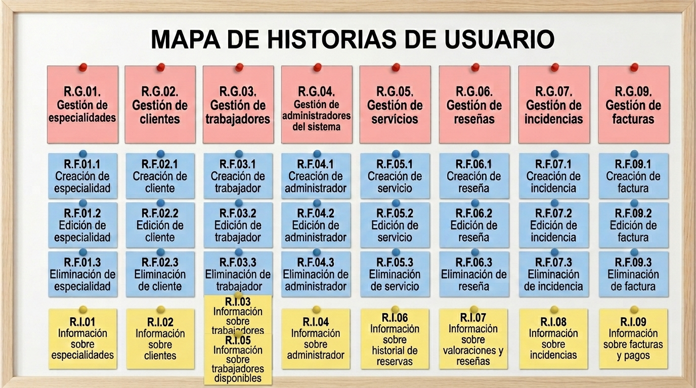

# CleanConnect

## Miembros del grupo L8-AM-3

1. Rodríguez Ortiz, David
2. Pérez Dot, Pol
3. Rodríguez González, Gerard
4. Ruiz Núñez, Manuel

---

## 1. Introducción al problema
Hoy en día, el ritmo de vida que llevamos y las jornadas de trabajo eternas hacen que las familias y los profesionales independientes no tengan tiempo libre. De toda la vida, contratar a alguien para limpiar en casa siempre ha sido gracias a recomendaciones de conocidos o gracias a agencias cuyas comisiones son altísimas. Al final de todo, es un sector donde hay muchísimo trabajo en negro, los precios nunca están fijados y cuesta la misma vida dar con alguien, establecer confianza y hallar huecos donde la persona este disponible.

En cuanto a los clientes, los principales problemas son la falta de confianza para meter a una persona ajena en tu casa, lo difícil que es encontrar a alguien disponible a las horas que te interesan, tener que pagar siempre en efectivo y no tener ningun tipo de referencia o descripción sobre la actitud de la persona.

En cuanto a los profesionales, se encuentran con que les cuesta bastante dar con clientes fijos, sufren impagos o cancelaciones a última hora, pierden muchísimo tiempo entre casa y casa, y encima no tienen herramientas profesionales para organizarse en el dia a dia.

Para solucionar todo esto proponemos el proyecto CleanConnect, que busca digitalizar y estructurar este sector mediante una aplicación móvil y web al estilo de Uber. La plataforma servirá de intermediaria para asegurar que los clientes puedan encontrar a alguien rápido de manera sencilla, ver perfiles con identidad verificada, consultar opiniones con estrellas y comentarios, y pagar de forma segura. Mientras tanto, a los profesionales les garantiza flexibilidad de horarios, cobrar siempre de manera segura, gestionar su agenda fácilmente e ir construyendo su propia reputación en el sector.

---

## 2. Glosario de términos
- Especialidad: Representa los distintos tipos de limpieza que se ofrecen. Sirve para categorizar las habilidades del trabajador y facilitar la búsqueda al cliente.

- Cliente: Usuarios que solicita y contrata los servicios de limpieza. Almacena sus datos personales, de contacto y su dirección.

- Trabajador: Representa a los profesionales que ofrecen sus servicios en la app. Incluye sus datos personales, el estado de verificación de su identidad, zona de trabajo y disponibilidad.

- Servicio: Es la entidad principal de la plataforma. Representa la reserva de un trabajo de limpieza concreto entre un cliente y un trabajador, guardando la fecha, hora, duración, ubicación y estado.

- Reseña: Guarda la valoración que realiza un cliente al terminar el servicio. Incluye una puntuación en estrellas y un comentario para construir la reputación pública del profesional.

- Incidencia: Registra los problemas reportados por los usuarios sobre un servicio para que el administrador pueda gestionarlos y resolverlos.

- Factura: Almacena los datos del pago y del comprobante de cada servicio realizado, desglosando el importe total, la comisión de la plataforma, los impuestos y el estado del cobro.

- Administrador: Representa al personal interno encargado de la gestión y supervisión de la plataforma. Almacena sus datos de acceso y permisos para validar las cuentas de los trabajadores, gestionar las especialidades y resolver las incidencias reportadas.
  
- Mensaje: Interacción entre un cliente y un trabajador acerca de un servicio. Incluye la fecha y la hora a la que se manda el mensaje y el contenido de este.
  
---

## 3. Visión general del sistema

### 3.1. Requisitos generales

  #### R.G.01. Gestión de especialidades   
Como administrador del sistema

Quiero gestionar las especialidades de limpieza disponibles

Para categorizar los servicios que pueden ofrecer los trabajadores  

  #### R.G.02. Gestión de clientes   
Como cliente

Quiero gestionar una cuenta y un perfil de cliente

Para poder contratar los servicios de limpieza de un trabajador

  #### R.G.03. Gestión de trabajadores   
Como trabajador

Quiero gestionar una cuenta y un perfil de trabajador

Para ofrecer mis servicios y poder ser contratado por un cliente 

  #### R.G.04. Gestión de administradores del sistema
Como administrador del sistema

Quiero gestionar las cuentas y perfiles de los usuarios

Para garantizar la autenticidad y seguridad de la plataforma 

  #### R.G.05. Gestión de servicios   
Como cliente

Quiero gestionar las reservas de servicios de limpieza

Para coordinar la asistencia de un trabajador a mi domicilio  
  
  #### R.G.06. Gestión de reseñas   
Como cliente

Quiero gestionar las reseñas sobre los trabajadores

Para construir la reputación pública de los profesionales 
  
  #### R.G.07. Gestión de incidencias   
Como administrador del sistema

Quiero gestionar las incidencias reportadas por los usuarios

Para resolver mediaciones y disputas de forma justa
  
  #### R.G.08. Gestión de mensajes
Como cliente o trabajador

Quiero gestionar los mensajes que le mando a otro usuario

Para mejorar la comunicación de cara a un servicio  

  #### R.G.09. Gestión de facturas
Como administrador 

Quiero gestionar las facturas de los servicios de los clientes 

Para que puedan observar el historial de sus facturas y pagos 

---
  
### 3.2. Usuarios del sistema
- Administrador: Representa al personal interno encargado de la gestión y supervisión de la plataforma. Almacena sus datos de acceso y permisos para validar las cuentas de los trabajadores, gestionar las especialidades y resolver las incidencias reportadas.
  
- Cliente: Usuarios que solicita y contrata los servicios de limpieza. Almacena sus datos personales, de contacto y su dirección.
  
- Trabajador: Representa a los profesionales que ofrecen sus servicios en la app. Incluye sus datos personales, el estado de verificación de su identidad, zona de trabajo y disponibilidad.

## 4. Catálogo de requisitos

### 4.1. Requisitos funcionales

#### R.F.01.1 Creación de especialidad
Como administrador del sistema

Quiero crear nuevas especialidades de limpieza

Para permitir que los trabajadores las añadan a su perfil

Prueba de aceptación: 

- No se puede crear una especialidad sin nombre o con nombre duplicado

#### R.F.01.2 Edición de especialidad
Como administrador del sistema

Quiero editar las especialidades existentes

Para actualizar sus nombres o descripciones

Prueba de aceptación:   

- Al editar una especialidad no se alteran las asignaciones previas a trabajadores

- No se puede dejar el nombre en blanco  

#### R.F.01.3 Eliminación de especialidad
Como administrador del sistema

Quiero eliminar especialidades obsoletas

Para mantener actualizado el catálogo de servicios

Prueba de aceptación:   

- Al eliminar una especialidad, se desvincula automáticamente de los trabajadores que la tenían seleccionada   

#### R.F.02.1 Creación de cliente
Como cliente

Quiero registrarme en la plataforma

Para poder reservar servicios de limpieza

Prueba de aceptación:   

- No se puede crear un cliente sin nombre, email  o teléfono ni dirección

#### R.F.02.2 Edición de cliente
Como cliente

Quiero actualizar mis datos o mi dirección

Para garantizar la localización correcta al solicitar un servicio

Prueba de aceptación:   

- No se puede dejar la dirección ni el teléfono/email vacíos  

#### R.F.02.3 Eliminación de cliente
Como cliente

Quiero eliminar mi perfil

Para darme de baja de la aplicación

Prueba de aceptación:   

- No puede haber ninguna factura sin pagar
- Los datos del cliente desaparecen de la base de datos

#### R.F.03.1 Creación de trabajador
Como trabajador

Quiero registrar mi perfil con DNI/NIE, teléfono móvil, especialidades y zona de trabajo

Para ofertar mis servicios en la plataforma

Prueba de aceptación:   
- La especialidad tiene que existir
- El DNI tiene que tener un formato válido
- El teléfono móvil tiene que tener un formato válido
- La zona de trabajo no puede estar vacía

#### R.F.03.2 Edición de trabajador
Como trabajador

Quiero editar en mi perfil mi teléfono móvil y/o zona de trabajo

Para actualizar mis servicios en la plataforma

Prueba de aceptación:   

- El teléfono móvil tiene que tener un formato válido
- La zona de trabajo no puede estar vacía

#### R.F.03.3 Eliminación de trabajador
Como trabajador

Quiero eliminar mi perfil 

Para finalizar mis servicios en la plataforma

Prueba de aceptación:   

- Que no tenga ninguna incidencia abierta sobre un servicio suyo
- Los datos del trabajador desaparecen de la base de datos

#### R.F.04.1 Creación de administrador
Como administrador

Quiero registrarme en la plataforma

Para poder administrar la plataformas

Prueba de aceptación:   

- No se puede crear un administrador sin nombre, email  o teléfono

#### R.F.04.2 Edición de administrador
Como administrador

Quiero editar mi perfil 

Para actualizar mis datos

Prueba de aceptación:   

- El email  y teléfono no pueden estar vacíos

#### R.F.04.3 Eliminación de administrador
Como administrador

Quiero eliminar mi usuario 

Para darme de baja en la plataforma

Prueba de aceptación:   

- Los datos del administrador desaparecen de la base de datos

#### R.F.05.1 Creación de servicio
Como cliente

Quiero solicitar la reserva de un servicio indicando fecha, hora, horas estimadas y trabajador

Para asegurar la asistencia del profesional a mi domicilio

Prueba de aceptación:   

- No se puede crear una reserva sin cliente, trabajador, fecha o dirección  

- Las horas de duración deben ser mayores que 0

- Se debe cumplir la regla de negocio R.N.05    

- Se debe cumplir la regla de negocio R.N.06   

#### R.F.05.2 Edición de servicio
Como cliente

Quiero modificar la fecha u hora de una reserva

Para adaptar el servicio a cambios en mi agenda.

Prueba de aceptación:   

- Se debe cumplir la regla de negocio R.N.01   

#### R.F.05.3 Eliminación de servicio
Como cliente o trabajador

Quiero cancelar una reserva programada

Para liberar el tiempo en la agenda

Prueba de aceptación:   

- Se aplica la penalización o reembolso según la regla de negocio R.N.01.  

#### R.F.06.1 Creación de reseña
Como cliente

Quiero valorar un servicio completado con una puntuación y comentario

Para expresar mi grado de satisfacción con el trabajador

Prueba de aceptación:   

- La puntuación debe estar comprendida entre 1 y 5
- Se debe cumplir la regla de negocio R.N.02.   

#### R.F.06.2 Edición de reseña
Como cliente

Quiero editar reseñas que haya realizado a algún servicio completado

Para corregir posibles errores al escribir dicha reseña

Prueba de aceptación:   

- Al cambiar la puntuación la reseña se recalcula automáticamente la nota media del trabajador
- La puntuación debe estar comprendida entre 1 y 5

#### R.F.06.3 Eliminación de reseña
Como cliente

Quiero eliminar reseñas que haya realizado a algún servicio completado

Para que no aparezca la reseña sobre el servicio completado

Prueba de aceptación:   

- Al eliminar la reseña se recalcula automáticamente la nota media del trabajador.

#### R.F.07.1 Creación de incidencia
Como cliente o trabajador

Quiero registrar una incidencia asociada a un servicio

Para solicitar la mediación del administrador ante un problema

Prueba de aceptación:  

- No se puede abrir una incidencia sin asociar un servicio existente.
    
- Se debe cumplir la regla de negocio R.N.04.   

#### R.F.07.2 Edición de incidencia
Como usuario

Quiero editar una incidencia abierta y registrada por mí

Para corregir algún fallo en la misma

Prueba de aceptación:   

- La incidencia tiene que estar activa

#### R.F.07.3 Eliminación de incidencia
Como cliente o trabajador

Quiero cancelar una incidencia abierta y registrada por mí

Para cerrar dicha incidencia

Prueba de aceptación:   

- La incidencia se borra

#### R.F.08.1 Creación de mensaje
Como cliente o trabajador

Quiero enviar un mensaje a otro usuario relativo a un servicio contratado

Para coordinar la llegada, la ubicación exacta o los detalles específicos de la limpieza

Prueba de aceptación:
- No se puede enviar un mensaje sin texto o compuesto únicamente por espacios en blanco.
- Debe existir un servicio que vincule al cliente y al trabajador.
- El sistema guarda automáticamente la fecha y hora de envío del mensaje.

#### R.F.08.2 Edición de mensaje
Como cliente o trabajador

Quiero editar un mensaje que haya enviado previamente

Para corregir errores de escritura o precisar la información proporcionada

Prueba de aceptación:
- Solo el usuario autor del mensaje puede modificar su contenido.
- No se puede dejar el texto del mensaje en blanco tras la edición.
- El mensaje editado mostrará un indicador visible de "editado" en el historial de conversación.

#### R.F.08.3 Eliminación de mensaje
Como cliente o trabajador

Quiero eliminar un mensaje enviado por mí en una conversación

Para retirar información enviada por error o que ya no resulte relevante

Prueba de aceptación:
- Solo el autor del mensaje puede eliminarlo.
- El mensaje desaparece del hilo de chat de la conversación para ambas partes.

#### R.F.09.1 Creación de factura
Como administrador

Quiero crear una factura sobre un servicio

Para que tanto el cliente como el trabajador puedan verlas

Prueba de aceptación:
- No se puede crear una factura sin precio
- Debe existir un servicio que vincule al cliente y al trabajador.
- No se pueden crear dos facturas iguales con misma fecha y hora

#### R.F.09.2 Edición de factura
Como administrador

Quiero editar una factura que haya enviado previamente

Para corregir errores en la factura

Prueba de aceptación:
- El precio no puede ser negativo
- Debe existir un servicio que vincule al cliente y al trabajador.
- No puede haber dos facturas iguales con misma fecha y hora

#### R.F.09.3 Eliminación de factura
Como administrador

Quiero eliminar una factura 

Para que no haya facturas duplicadas o con errores

Prueba de aceptación:
- La factura se elimina correctamente

#### 4.1.1. Requisitos de información

##### R.I.01 Información sobre especialidades
Como administrador del sistema

Quiero disponer del listado de especialidades con el número de trabajadores asignados a cada una

Para analizar la oferta de servicios de la plataforma

Prueba de aceptación:  

- El sistema muestra el nombre, descripción y recuento de profesionales por especialidad.

##### R.I.02 Información sobre clientes
Como cliente

Quiero que el sistema muestre mi perfil

Para comprobar que mis datos aparecen correctamente

Prueba de aceptación: 

- El sistema muestra el nombre, teléfono, email y dirección.

##### R.I.03 Información sobre trabajadores
Como trabajador

Quiero que el sistema muestre mi perfil

Para comprobar que mis datos aparecen correctamente

Prueba de aceptación: 

- El sistema muestra el nombre, teléfono, email y zona de trabajo.

##### R.I.04 Información sobre administrador
Como administrador

Quiero que el sistema muestre mi perfil

Para comprobar que mis datos aparecen correctamente

Prueba de aceptación: 

- El sistema muestra el nombre, teléfono y email.

##### R.I.05 Información sobre trabajadores disponibles
Como cliente

Quiero disponer de la lista de trabajadores filtrada por especialidad, valoración, tarifa máxima y disponibilidad

Para seleccionar al profesional idóneo.

Prueba de aceptación:  

- El sistema lista nombre, foto, especialidades, tarifa por hora y nota media calculada de los trabajadores validados.
  
##### R.I.06 Información sobre historial de reservas
Como cliente o trabajador

Quiero consultar la información de mis reservas pasadas y futuras, incluyendo fecha, horas, dirección y estado

Para llevar el seguimiento de mis servicios

Prueba de aceptación:  

- El sistema muestra la lista detallada de reservas vinculadas al usuario   

##### R.I.07 Información sobre valoraciones y reseñas
Como cliente

Quiero consultar la lista de valoraciones de un trabajador, incluyendo estrellas y comentarios de clientes previos

Para comprobar su reputación antes de contratar

Prueba de aceptación:  

- El sistema muestra las opiniones asociadas a servicios completados del trabajador  

##### R.I.08 Información sobre incidencias
Como administrador del sistema

Quiero disponer de la lista de incidencias pendientes de resolución con fecha, emisor, tipo y servicio afectado

Para intervenir oportunamente en los conflictos

Prueba de aceptación:  

- El sistema presenta la lista ordenada por fecha de apertura.   

##### R.I.09 Información sobre facturas y pagos
Como cliente

Quiero disponer del desglose del importe pagado en cada servicio

Para tener comprobantes de pago de mis contrataciones

Prueba de aceptación: 

- El sistema muestra el id del servicio, fecha, horas realizadas, tarifa/hora e importe total pagado.

##### R.I.10 Información sobre mensajes
Como cliente o trabajador

Quiero ver los mensajes enviados y recibidos sobre un servicio

Para mejorar la comunicación en el servicio

Prueba de aceptación: 

- El sistema muestra los mensajes enviados, recibidos y la fecha y hora de cada uno.

---

#### 4.1.2. Reglas de negocio

#### R.N.01. Cambios y cancelaciones de reservas
Como administrador del sistema

Quiero que los clientes puedan modificar o cancelar la reserva sin coste hasta 12 horas antes del inicio previsto

Para dar flexibilidad al cliente sin perjudicar el tiempo reservado del trabajador. Si se cancela con menos de 12 horas, se cobrará al cliente 1 hora de servicio como penalización.   

#### R.N.02. Restricción de reseñas
Como administrador del sistema

Quiero que solo se pueda redactar una reseña si existe un servicio con estado "Completado" vinculado entre el cliente y el trabajador

Para evitar valoraciones falsas o manipulación de la reputación.   

#### R.N.03. Suspensión por baja calificación
Como administrador del sistema

Quiero que si la nota media de un trabajador cae por debajo de 2.0 estrellas (tras acumular al menos 5 reseñas), su perfil pase automáticamente al estado "Suspendido"

Para garantizar unos estándares mínimos de calidad en el servicio.   

#### R.N.04. Retención de cobro por incidencia
Como administrador del sistema

Quiero que si hay una incidencia activa sobre un servicio, el pago correspondiente se mantenga retenido

Para evitar transferir dinero al trabajador hasta que el conflicto sea resuelto por el administrador.   

#### R.N.05. Rebaja del primer servicio
Como administrador del sistema

Quiero que el primer servicio que contrate un cliente no cuente con comisión por parte de la aplicación

Para garantizar una buena primera experiencia al cliente

#### R.N.06. Validación obligatoria de trabajadores
Como administrador del sistema

Quiero que un trabajador solo aparezca en las búsquedas si su estado es "Validado"

Para garantizar que todos los profesionales hayan pasado la verificación de identidad.

---

### 4.2. Mapa de historias de usuario (opcional)

  

---

### 4.3. Requisitos no funcionales (opcional)

#### R.N.F. 01. Tiempo de respuesta en búsquedas

Como cliente,

quiero que el tiempo de respuesta al filtrar trabajadores sea menor a 2 segundos con hasta 1000 usuarios concurrentes,

para mejorar la experiencia de uso y evitar la frustración en la navegación.

#### R.N.F. 02. Protección y control de acceso

Como administrador,

quiero que las contraseñas se almacenen cifradas y los datos personales estén protegidos con control de acceso por roles,

para cumplir con la Ley de Protección de Datos y garantizar la privacidad de los usuarios.

#### R.N.F. 03. Disponibilidad del servicio

Como administrador,

quiero que la aplicación esté disponible a todas horas,

para facilitar las contrataciones de servicios de limpieza en cualquier momento.

#### R.N.F. 04. Compatibilidad web

Como usuario,

quiero poder usar la plataforma desde navegadores web estándar,

para poder acceder a la aplicación desde cualquier dispositivo y navegador.

#### R.N.F. 05. Seguridad en el procesamiento de pagos

Como cliente,

quiero que el procesamiento de pagos se realice mediante una pasarela externa certificada,

para garantizar que los datos bancarios no sean almacenados en los servidores de la plataforma.

---

-- fin entregable 1 --

## 5. Modelo conceptual

### 5.1. Diagramas de clases UML

- con restricciones.

### 5.2. Escenarios de prueba

- con descripción textual y diagrama de objetos UML.

## 6. Matrices de trazabilidad

- Matriz de trazabilidad entre los elementos del modelo conceptual y los requisitos.

|       | EntidadX   | AsociaciónX  | RestricciónX  | Entidad2 ...   | 
|:------|:-----------|:-----------|:-----------|:-----------|
| RI-1  | X          | X          | X          | X          |
| RI-2  |            | X          |            | X          |
| RF-1  |            | X          |            | X          |
| RF-2  | X          |            | X          | X          |
| RN-1  |            | X          |            |            |
| RN-2  | X          | X          | X          |            |
| ...   |            |            |            |            |

-- fin entregable 2 --

## 7. Modelo relacional en 3FN

- Relaciones obtenidas al aplicar la transformación del modelo conceptual.

### 7.1.  Justificación de la estrategia de transformación de jerarquías

- si se identificaron jerarquías en el MC.

### 8. Matriz de trazabilidad MC/SQL (opcional):

- Restricciones sobre el MC / Elementos del modelo tecnológico (SQL) (Triggers, checks, etc.)
- Incluir Reglas de negocio — Constraints/Triggers en las matrices de trazabilidad para el entregable 3

|       | EntidadX   | AsociaciónX  | RestricciónX  | Entidad2 ...   | 
|:-------|:-------|:-------|:-------|:-------|
| TABLA-1 |        |        |        |        |
| TABLA-2 |        |        |        |        |
| TABLA-3 |        |        |        |        |
| TABLA-4 |        |        |        |        |
| TRIG-1 |        |        |        |        |
| TRIG-2 | X      | X      |        | X      |
| TRIG-3 |        | X      |        | X      |
| TRIG-4 |        |        | X      |        |
| CONST-1 |        |        |        |        |
| CONST-2 | X      | X      |        | X      |
| CONST-3 |        | X      |        | X      |
| CONST-4 |        |        | X      |        |

Se consideran todo tipo de constraints declarativas (aquellas definidas durante el CREATE TABLE).
-- fin entregable 3 --

## Referencias

