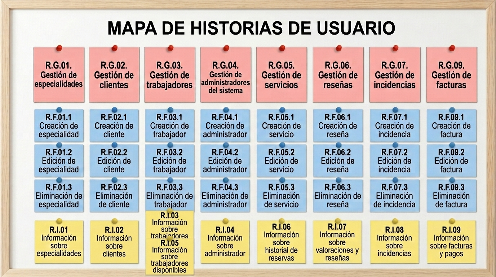

# CleanConnect

## Miembros del grupo L8-AM-3

1. Rodríguez Ortiz, David
2. Pérez Dot, Pol
3. Rodríguez González, Gerard
4. Ruiz Núñez, Manuel

---

## 1. Introducción al problema
Hoy en día, el ritmo de vida que llevamos y las jornadas de trabajo eternas hacen que las familias y los profesionales independientes no tengan tiempo libre. De toda la vida, contratar a alguien para limpiar en casa siempre ha sido gracias a recomendaciones de conocidos o gracias a agencias cuyas comisiones son altísimas. Al final de todo, es un sector donde hay muchísimo trabajo en negro, los precios nunca están fijados y cuesta la misma vida dar con alguien, establecer confianza y hallar huecos donde la persona este disponible.

En cuanto a los clientes, los principales problemas son la falta de confianza para meter a una persona ajena en tu casa, lo difícil que es encontrar a alguien disponible a las horas que te interesan, tener que pagar siempre en efectivo y no tener ningun tipo de referencia o descripción sobre la actitud de la persona.

En cuanto a los profesionales, se encuentran con que les cuesta bastante dar con clientes fijos, sufren impagos o cancelaciones a última hora, pierden muchísimo tiempo entre casa y casa, y encima no tienen herramientas profesionales para organizarse en el dia a dia.

Para solucionar todo esto proponemos el proyecto CleanConnect, que busca digitalizar y estructurar este sector mediante una aplicación móvil y web al estilo de Uber. La plataforma servirá de intermediaria para asegurar que los clientes puedan encontrar a alguien rápido de manera sencilla, ver perfiles con identidad verificada, consultar opiniones con estrellas y comentarios, y pagar de forma segura. Mientras tanto, a los profesionales les garantiza flexibilidad de horarios, cobrar siempre de manera segura, gestionar su agenda fácilmente e ir construyendo su propia reputación en el sector.

---

## 2. Glosario de términos
- Especialidad: Representa los distintos tipos de limpieza que se ofrecen. Sirve para categorizar las habilidades del trabajador y facilitar la búsqueda al cliente.

- Cliente: Usuarios que solicita y contrata los servicios de limpieza. Almacena sus datos personales, de contacto y su dirección.

- Trabajador: Representa a los profesionales que ofrecen sus servicios en la app. Incluye sus datos personales, el estado de verificación de su identidad, zona de trabajo y disponibilidad.

- Servicio: Es la entidad principal de la plataforma. Representa la reserva de un trabajo de limpieza concreto entre un cliente y un trabajador, guardando la fecha, hora, duración, ubicación y estado.

- Reseña: Guarda la valoración que realiza un cliente al terminar el servicio. Incluye una puntuación en estrellas y un comentario para construir la reputación pública del profesional.

- Incidencia: Registra los problemas reportados por los usuarios sobre un servicio para que el administrador pueda gestionarlos y resolverlos.

- Factura: Almacena los datos del pago y del comprobante de cada servicio realizado, desglosando el importe total, la comisión de la plataforma, los impuestos y el estado del cobro.

- Administrador: Representa al personal interno encargado de la gestión y supervisión de la plataforma. Almacena sus datos de acceso y permisos para validar las cuentas de los trabajadores, gestionar las especialidades y resolver las incidencias reportadas.
  
- Mensaje: Interacción entre un cliente y un trabajador acerca de un servicio. Incluye la fecha y la hora a la que se manda el mensaje y el contenido de este.
  
---

## 3. Visión general del sistema

### 3.1. Requisitos generales

  #### R.G.01. Gestión de especialidades   
Como administrador del sistema

Quiero gestionar las especialidades de limpieza disponibles

Para categorizar los servicios que pueden ofrecer los trabajadores  

  #### R.G.02. Gestión de clientes   
Como cliente

Quiero gestionar una cuenta y un perfil de cliente

Para poder contratar los servicios de limpieza de un trabajador

  #### R.G.03. Gestión de trabajadores   
Como trabajador

Quiero gestionar una cuenta y un perfil de trabajador

Para ofrecer mis servicios y poder ser contratado por un cliente 

  #### R.G.04. Gestión de administradores del sistema
Como administrador del sistema

Quiero gestionar las cuentas y perfiles de los usuarios

Para garantizar la autenticidad y seguridad de la plataforma 

  #### R.G.05. Gestión de servicios   
Como cliente

Quiero gestionar las reservas de servicios de limpieza

Para coordinar la asistencia de un trabajador a mi domicilio  
  
  #### R.G.06. Gestión de reseñas   
Como cliente

Quiero gestionar las reseñas sobre los trabajadores

Para construir la reputación pública de los profesionales 
  
  #### R.G.07. Gestión de incidencias   
Como administrador del sistema

Quiero gestionar las incidencias reportadas por los usuarios

Para resolver mediaciones y disputas de forma justa
  
  #### R.G.08. Gestión de mensajes
Como cliente o trabajador

Quiero gestionar los mensajes que le mando a otro usuario

Para mejorar la comunicación de cara a un servicio  

  #### R.G.09. Gestión de facturas
Como administrador 

Quiero gestionar las facturas de los servicios de los clientes 

Para que puedan observar el historial de sus facturas y pagos 

---
  
### 3.2. Usuarios del sistema
- Administrador: Representa al personal interno encargado de la gestión y supervisión de la plataforma. Almacena sus datos de acceso y permisos para validar las cuentas de los trabajadores, gestionar las especialidades y resolver las incidencias reportadas.
  
- Cliente: Usuarios que solicita y contrata los servicios de limpieza. Almacena sus datos personales, de contacto y su dirección.
  
- Trabajador: Representa a los profesionales que ofrecen sus servicios en la app. Incluye sus datos personales, el estado de verificación de su identidad, zona de trabajo y disponibilidad.

## 4. Catálogo de requisitos

### 4.1. Requisitos funcionales

#### R.F.01.1 Creación de especialidad

#### 4.1.1. Requisitos de información

##### R.I.01 Información sobre especialidades
Como administrador del sistema,

quiero disponer de la siguiente información sobre las especialidades de limpieza:

El nombre y la descripción de la especialidad.

El número de trabajadores asignados a cada especialidad.

Para categorizar las habilidades de los trabajadores y analizar la oferta de servicios de la plataforma.

##### R.I.02 Información sobre clientes
Como administrador del sistema o trabajador,

quiero almacenar la siguiente información sobre los clientes:

Datos personales (nombre y apellidos).

Datos de contacto (teléfono y correo electrónico).

Dirección postal completa de su domicilio.

Para identificar al usuario y coordinar la localización de los servicios de limpieza contratados.

##### R.I.03 Información sobre trabajadores
Como cliente o administrador del sistema,

quiero almacenar la siguiente información sobre los trabajadores:

Datos personales y de contacto.

Estado de verificación de identidad (Pendiente, Validado, Suspendido).

Zona de trabajo y disponibilidad horaria.

Tarifa por hora y especialidades asignadas.

Nota media de valoraciones calculada.

Para evaluar el perfil del profesional y permitir su selección en las búsquedas de la plataforma.

##### R.I.04 Información sobre administrador
Como administrador del sistema,

quiero almacenar la siguiente información sobre el personal interno:

Datos personales y de contacto.

Nombre de usuario y credenciales de acceso (contraseña cifrada).

Permisos y rol dentro de la plataforma.

Para gestionar, validar cuentas y supervisar el funcionamiento seguro del sistema.

##### R.I.06 Información sobre historial de reservas
Como cliente o trabajador,

quiero almacenar la siguiente información sobre los servicios de limpieza:

Fecha, hora de inicio y duración estimada del servicio.

Ubicación exacta donde se prestará el servicio.

Estado actual de la reserva (Pendiente, Aceptado, Completado, Cancelado).

Vínculo con el cliente que solicita, el trabajador asignado y la especialidad contratada.

Para llevar el seguimiento, control y trazabilidad del historial de reservas pasadas y futuras.  

##### R.I.07 Información sobre valoraciones y reseñas
Como cliente o trabajador,

quiero almacenar la siguiente información sobre las valoraciones de los servicios:

Puntuación en estrellas (valor numérico de 1 a 5).

Comentario descriptivo redactado por el cliente.

Fecha de publicación de la reseña.

Servicio completado al que está vinculada la reseña.

Para construir y verificar la reputación pública de los profesionales en el sector.

##### R.I.08 Información sobre incidencias
Como administrador del sistema,

quiero almacenar la siguiente información sobre los problemas reportados:

Fecha y hora de apertura de la incidencia.

Usuario emisor que reporta el problema (cliente o trabajador).

Tipo/categoría de la incidencia y descripción detallada del conflicto.

Estado de la incidencia (Pendiente, En mediación, Resuelta).

Servicio afectado asociado.

Para tramitar la resolución de disputas, gestionar mediaciones y retener pagos si procede.

##### R.I.09 Información sobre facturas y pagos
Como cliente o administrador del sistema,

quiero almacenar la siguiente información sobre los pagos y comprobantes:

Identificador único de la factura.

Fecha y hora de emisión del pago.

Desglose del importe (horas realizadas, tarifa por hora, comisión de la plataforma e impuestos aplicados).

Estado del cobro (Pagado, Retenido por incidencia, Reembolsado).

Servicio al que corresponde la factura.

Para disponer de justificantes de cobro, aplicar exenciones de comisiones y consultar el historial de transacciones.

##### R.I.10 Información sobre mensajes
Como cliente o trabajador,

quiero almacenar la siguiente información sobre las interacciones del chat:

Fecha y hora exacta de envío.

Texto o contenido del mensaje.

Usuario emisor y usuario receptor.

Servicio al que hace referencia la conversación.

Para mantener la trazabilidad de la comunicación previa y posterior a la ejecución del servicio.

---

#### 4.1.2. Reglas de negocio

#### R.N.01. Cambios y cancelaciones de reservas
Como administrador del sistema

Quiero que los clientes puedan modificar o cancelar la reserva sin coste hasta 12 horas antes del inicio previsto

Para dar flexibilidad al cliente sin perjudicar el tiempo reservado del trabajador. Si se cancela con menos de 12 horas, se cobrará al cliente 1 hora de servicio como penalización.   

Pruebas de aceptación:

-)Caso de éxito (sin penalización): Un cliente cancela una reserva programada para el día siguiente con 15 horas de antelación. El sistema anula la cita correctamente y no aplica ningún cargo adicional.

-)Caso de penalización: Un cliente cancela una reserva con 3 horas de antelación sobre la hora prevista. El sistema aplica y registra de manera automática un cargo equivalente a 1 hora de servicio como penalización para el cliente.

#### R.N.02. Restricción de reseñas
Como administrador del sistema

Quiero que solo se pueda redactar una reseña si existe un servicio con estado "Completado" vinculado entre el cliente y el trabajador

Para evitar valoraciones falsas o manipulación de la reputación.   

Pruebas de aceptación:

-)Caso válido: Un cliente accede a un servicio que figura con el estado "Completado", introduce una puntuación en estrellas y un comentario, y el sistema almacena la reseña correctamente.

-)Caso denegado: Un cliente intenta redactar una reseña sobre un servicio que se encuentra en estado "Pendiente" o "Aceptado" (aún no realizado), y el sistema bloquea la acción mostrando un mensaje de error por no cumplir la condición.

#### R.N.03. Suspensión por baja calificación
Como administrador del sistema

Quiero que si la nota media de un trabajador cae por debajo de 2.0 estrellas (tras acumular al menos 5 reseñas), su perfil pase automáticamente al estado "Suspendido"

Para garantizar unos estándares mínimos de calidad en el servicio.   

Pruebas de aceptación:

-)Caso de suspensión automática: Un trabajador que ya cuenta con 5 reseñas y una nota media de 2.2 recibe una nueva valoración de 1 estrella, lo que hace que su media global baje a 1.9. El sistema actualiza de forma automática su estado a "Suspendido".

-)Caso de excepción por volumen insuficiente: Un trabajador nuevo que solo tiene 2 reseñas recibe una valoración muy baja que sitúa su media en 1.5 estrellas. Como aún no alcanza el mínimo de 5 reseñas requeridas, el sistema no suspende su cuenta.

#### R.N.04. Retención de cobro por incidencia
Como administrador del sistema

Quiero que si hay una incidencia activa sobre un servicio, el pago correspondiente se mantenga retenido

Para evitar transferir dinero al trabajador hasta que el conflicto sea resuelto por el administrador.   

Pruebas de aceptación:

-)Caso de retención: Un cliente reporta una incidencia grave sobre un servicio recién finalizado. El sistema bloquea el traspaso de fondos al trabajador y marca la factura asociada con el estado "Retenido por incidencia".

-)Caso de liberación posterior: El administrador interviene, resuelve la disputa a favor del trabajador y cierra la incidencia. El sistema actualiza el estado de la factura a "Pagado" y procede a liberar la transferencia de los fondos.

#### R.N.05. Rebaja del primer servicio
Como administrador del sistema

Quiero que el primer servicio que contrate un cliente no cuente con comisión por parte de la aplicación

Para garantizar una buena primera experiencia al cliente

Pruebas de aceptación:

-)Caso de primer servicio (sin comisión): Un cliente recién registrado en la plataforma efectúa su primera contratación. Al generar el desglose de la factura, el sistema aplica un valor de 0 € en el concepto de comisión de la plataforma.

-)Caso de servicios posteriores (con comisión): El mismo cliente realiza su segundo servicio de limpieza. Al emitir la factura, el sistema calcula e incluye de forma normal el porcentaje de comisión correspondiente a la plataforma.

#### R.N.06. Validación obligatoria de trabajadores
Como administrador del sistema

Quiero que un trabajador solo aparezca en las búsquedas si su estado es "Validado"

Para garantizar que todos los profesionales hayan pasado la verificación de identidad.

Pruebas de aceptación:

-)Caso excluido: Un profesional se registra en la plataforma y aporta su documentación, pero su cuenta permanece con el estado "Pendiente". Un cliente realiza una búsqueda de trabajadores por especialidad y zona, y dicho profesional no aparece en los resultados.

-)Caso incluido: El administrador valida la identidad del trabajador y su estado cambia a "Validado". Al repetir la búsqueda, el trabajador pasa a ser visible inmediatamente en los listados del cliente.

---

### 4.2. Mapa de historias de usuario (opcional)

  

---

### 4.3. Requisitos no funcionales (opcional)

#### R.N.F. 01. Tiempo de respuesta en búsquedas

Como cliente,

quiero que el tiempo de respuesta al filtrar trabajadores sea menor a 2 segundos con hasta 1000 usuarios concurrentes,

para mejorar la experiencia de uso y evitar la frustración en la navegación.

#### R.N.F. 02. Protección y control de acceso

Como administrador,

quiero que las contraseñas se almacenen cifradas y los datos personales estén protegidos con control de acceso por roles,

para cumplir con la Ley de Protección de Datos y garantizar la privacidad de los usuarios.

#### R.N.F. 03. Disponibilidad del servicio

Como administrador,

quiero que la aplicación esté disponible a todas horas,

para facilitar las contrataciones de servicios de limpieza en cualquier momento.

#### R.N.F. 04. Compatibilidad web

Como usuario,

quiero poder usar la plataforma desde navegadores web estándar,

para poder acceder a la aplicación desde cualquier dispositivo y navegador.

#### R.N.F. 05. Seguridad en el procesamiento de pagos

Como cliente,

quiero que el procesamiento de pagos se realice mediante una pasarela externa certificada,

para garantizar que los datos bancarios no sean almacenados en los servidores de la plataforma.

---

-- fin entregable 1 --

## 5. Modelo conceptual

### 5.1. Diagramas de clases UML

- con restricciones.

### 5.2. Escenarios de prueba

- con descripción textual y diagrama de objetos UML.

## 6. Matrices de trazabilidad

- Matriz de trazabilidad entre los elementos del modelo conceptual y los requisitos.

|       | EntidadX   | AsociaciónX  | RestricciónX  | Entidad2 ...   | 
|:------|:-----------|:-----------|:-----------|:-----------|
| RI-1  | X          | X          | X          | X          |
| RI-2  |            | X          |            | X          |
| RF-1  |            | X          |            | X          |
| RF-2  | X          |            | X          | X          |
| RN-1  |            | X          |            |            |
| RN-2  | X          | X          | X          |            |
| ...   |            |            |            |            |

-- fin entregable 2 --

## 7. Modelo relacional en 3FN

- Relaciones obtenidas al aplicar la transformación del modelo conceptual.

### 7.1.  Justificación de la estrategia de transformación de jerarquías

- si se identificaron jerarquías en el MC.

### 8. Matriz de trazabilidad MC/SQL (opcional):

- Restricciones sobre el MC / Elementos del modelo tecnológico (SQL) (Triggers, checks, etc.)
- Incluir Reglas de negocio — Constraints/Triggers en las matrices de trazabilidad para el entregable 3

|       | EntidadX   | AsociaciónX  | RestricciónX  | Entidad2 ...   | 
|:-------|:-------|:-------|:-------|:-------|
| TABLA-1 |        |        |        |        |
| TABLA-2 |        |        |        |        |
| TABLA-3 |        |        |        |        |
| TABLA-4 |        |        |        |        |
| TRIG-1 |        |        |        |        |
| TRIG-2 | X      | X      |        | X      |
| TRIG-3 |        | X      |        | X      |
| TRIG-4 |        |        | X      |        |
| CONST-1 |        |        |        |        |
| CONST-2 | X      | X      |        | X      |
| CONST-3 |        | X      |        | X      |
| CONST-4 |        |        | X      |        |

Se consideran todo tipo de constraints declarativas (aquellas definidas durante el CREATE TABLE).
-- fin entregable 3 --

## Referencias

